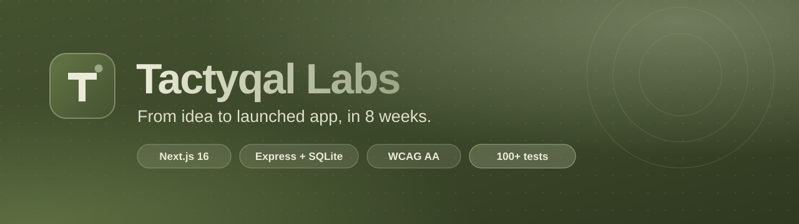
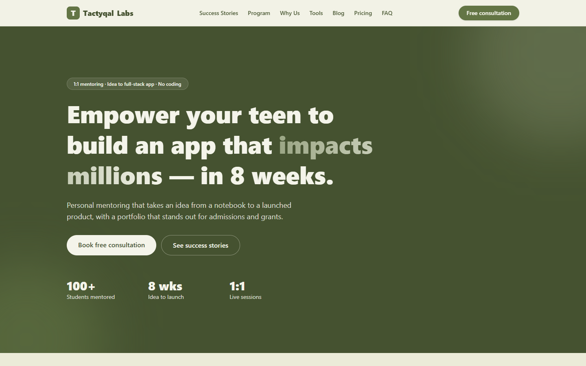
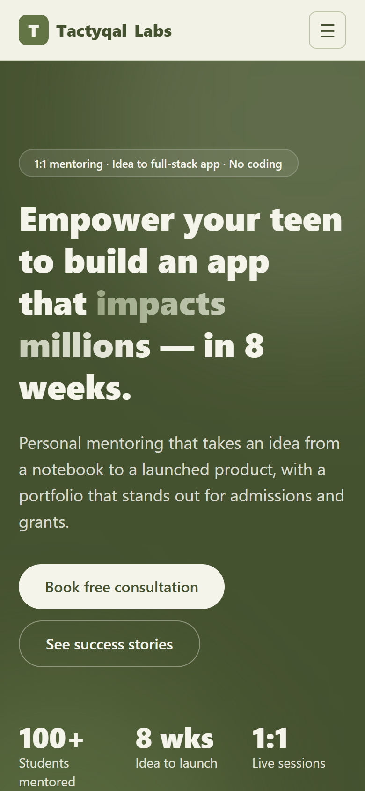
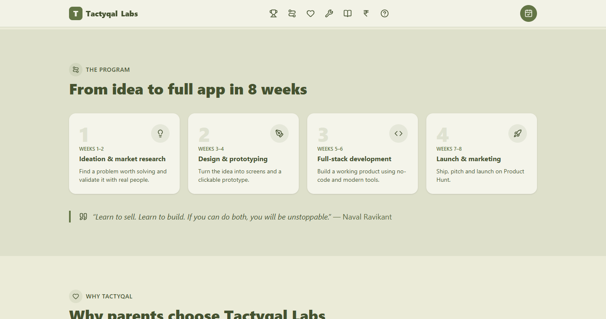
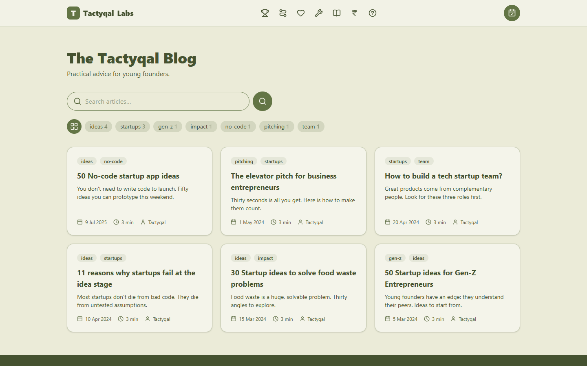
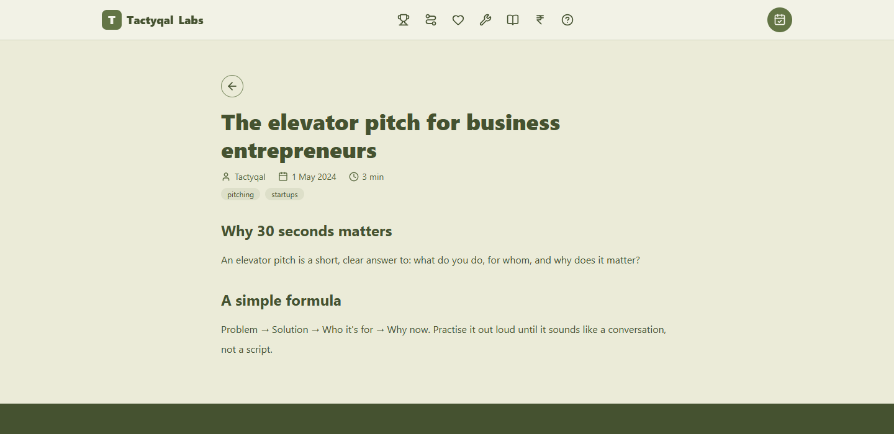
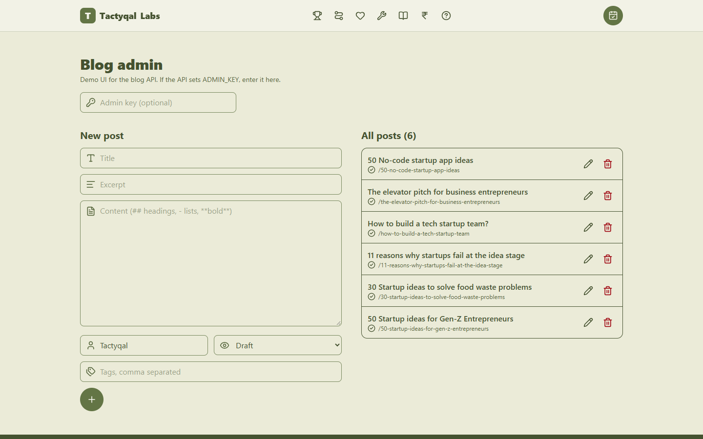
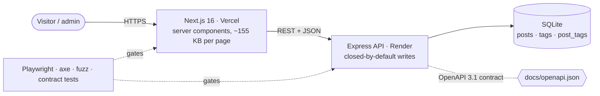

<div align="center">



<br/>

# Tactyqal Launchpad

**A redesigned Next.js homepage and a secure, tested blog API for [Tactyqal Labs](https://tactyqal.com/).**
*From idea to launched app, in 8 weeks.*

<br/>

[](https://tactyqal-launchpad.vercel.app)
[](https://tactyqal-launchpad-api.onrender.com/api/posts)
[](docs/openapi.json)

[](https://github.com/Slv-WebTech/tactyqal-launchpad/actions/workflows/ci.yml)


[**Live demo**](https://tactyqal-launchpad.vercel.app) · [**API**](https://tactyqal-launchpad-api.onrender.com/api/posts) · [**Docs**](#-documentation) · [**Project status**](#-project-status) · [**Report a bug**](https://github.com/Slv-WebTech/tactyqal-launchpad/issues/new/choose)

</div>

---

## ✨ What this is

Tactyqal Labs mentors teenagers from a first idea to a launched full-stack app. Their marketing site runs on CodeIgniter with the blog on a separate WordPress install. This project explores a better foundation, built for the *Fullstack Developer Intern* hire-a-thon:

| | Task | Delivered |
|---|---|---|
| 🎨 | **Homepage redesign** | Responsive Next.js 16 + Tailwind 4 site, same content and section order, new design system, accessibility-checked |
| 🧱 | **Blog backend** | REST API with a relational schema, full CRUD, search, tags, pagination, drafts and an admin UI, replacing WordPress |
| ✅ | **Quality bar** | Unit, contract, fuzz, accessibility, visual and end-to-end tests, plus live-site checks |

<br/>

<table>
<tr>
<td width="62%"></td>
<td width="38%"></td>
</tr>
</table>

<details>
<summary><b>More screenshots</b></summary>
<br/>

| Program section | Blog |
|---|---|
|  |  |
| **Post page** | **Admin** |
|  |  |

</details>

## 🎨 Design system

Four colours, nothing else. Tints are `color-mix` of these, so the UI always stays on-palette, and every text pair is verified for WCAG AA contrast.


Tokens live in [`frontend/app/globals.css`](frontend/app/globals.css); change the brand by editing one block. Logo, banner, favicon set and social cards are in [`docs/assets`](docs/assets) and are regenerated by [`e2e/scripts/generate-brand-assets.mjs`](e2e/scripts/generate-brand-assets.mjs).

## 🏗️ Architecture



<details>
<summary><b>Repository layout</b></summary>

```
tactyqal-launchpad/
├── frontend/   Next.js 16 app (home, blog, post, admin), design tokens, SEO metadata
├── backend/    Express 4 API on node:sqlite, config, tests (unit, edge, contract, fuzz)
├── e2e/        Playwright: functional, accessibility (axe), visual, live smoke, perf budgets
├── docs/       OpenAPI spec, audit and QA reports, brand assets, video script
└── .github/    CI, issue and PR templates, CODEOWNERS, Dependabot
```
</details>

## 🚀 Quick start

```bash
# 1. API on :4000 (seeds 6 posts on first run)
cd backend && npm install
ALLOW_OPEN_WRITES=1 npm start            # local dev only: writes open without a key
# or:  ADMIN_KEY=<24+ random chars> npm start     (then paste the key on /admin)

# 2. Site on :3000
cd frontend && npm install && cp .env.example .env.local && npm run dev
```

PowerShell: `$env:ALLOW_OPEN_WRITES=1; npm start`. Node ≥ 22.5 is required (`node:sqlite`). Pages: `/` · `/blog` · `/blog/:slug` · `/admin`.

## 🔌 Blog API

Base URL `…/api`. Full contract: [`docs/openapi.json`](docs/openapi.json).

| Method | Path | Notes |
|---|---|---|
| `GET` | `/posts` | `q`, `tag`, `status` (`published` default; `draft`/`all` need the key), `page`, `limit` ≤ 50 |
| `GET` | `/posts/:idOrSlug` | Drafts return 404 without the key |
| `POST` | `/posts` | 🔒 `{title*, excerpt, content, author, cover_image, status, tags[]}` |
| `PUT` `PATCH` | `/posts/:idOrSlug` | 🔒 Partial update, atomic with tags |
| `DELETE` | `/posts/:idOrSlug` | 🔒 `204` |
| `GET` | `/tags` · `/health` · `/ready` | Tag counts (published only), liveness, DB readiness |

## 🔐 Security

- **Closed by default.** No `ADMIN_KEY` means every write returns `401`. `ALLOW_OPEN_WRITES=1` is a local-development opt-in and is **refused when `NODE_ENV=production`**.
- Keys must be ≥ 24 characters and are compared in constant time. Secrets live only in environment variables; `.env*` files are git-ignored and CI scans for leaked credentials.
- All SQL is parameterised; the renderer escapes before formatting; oversized, malformed and hostile requests return structured `4xx` errors that never leak internals.
- Known gaps (tracked in [Project status](#-project-status)): rate limiting, security headers/CSP on the API, `cover_image` URL validation.

Report a vulnerability privately: see [SECURITY.md](SECURITY.md).

## 🧪 Quality

| Layer | Command | Count |
|---|---|---|
| API unit · edge · hardening · **OpenAPI contract** · **fuzz** | `cd backend && npm test` | 45 · 98.6 % lines · 95 % branches |
| Renderer unit | `cd frontend && npm test` | 7 · 100 % |
| E2E functional · **axe WCAG A/AA** · **visual regression** | `cd e2e && npx playwright test` | 64 |
| Live site (read-only) | `npx playwright test -c live-site.config.js` | 52 |
| Live API smoke + contract | `npx playwright test -c live.config.js` | 19 |
| Core Web Vitals + payload budgets | `node perf/vitals.mjs` | 8 page profiles |

Highlights: a seeded fuzzer fires 600 hostile requests per seed (4,800 across 8 seeds, zero 5xx); visual thresholds were **mutation-checked** (a wrong brand colour and a 2 px shift both fail); axe found and fixed 7 accessibility defects. Details: [QA report](docs/QA_REPORT.md) · [backend audit](docs/BACKEND_AUDIT.md).

## ⚡ Performance (live, mobile profile: 4× CPU, 4G)

| Page | LCP | CLS | Transfer |
|---|---|---|---|
| Home | 1.26 s | 0.000 | 156 KB |
| Blog | 1.00 s | 0.000 | 160 KB |
| Post | 1.00 s | 0.000 | 154 KB |

Backend: deep pagination went from 2.3 s to ~45 ms per request under load after indexing the sort order and dropping full-body reads from list queries.

## 📋 Project status

*Last updated 2026-11-20.*

| Area | Status |
|---|---|
| Homepage redesign | ✅ Done, deployed |
| Blog API + admin UI | ✅ Done, deployed; writes locked down with an admin key |
| Accessibility, visual and e2e suites | ✅ Done |
| OpenAPI contract + fuzzing | ✅ Done |
| SEO / social metadata, icons, manifest | ✅ Done |
| Render API runs the latest commit | ⏳ **Pending a manual deploy** (adds the malformed-URL `400` fix) |
| GitHub Actions CI (Backend · Frontend · E2E · Security) | ✅ Done |
| Rate limiting, API security headers, `cover_image` validation | 🔜 Planned |
| Idempotency keys, edit-conflict detection, full-text search, PostgreSQL | 🔜 Planned (see audit) |
| Cross-browser (Firefox/WebKit), mutation testing, load tests | 🔜 Planned |

> **Free-tier note:** the API sleeps when idle (first request ≈ 50 s) and its SQLite file resets on restart, so posts created in `/admin` are not permanent on the hosted demo.

## 📚 Documentation

| Doc | What's inside |
|---|---|
| [CONTEXT.md](CONTEXT.md) | Project context, decisions, conventions, current state: start here |
| [CHANGELOG.md](CHANGELOG.md) | What changed and when |
| [docs/QA_REPORT.md](docs/QA_REPORT.md) | End-to-end QA findings and metrics |
| [docs/BACKEND_AUDIT.md](docs/BACKEND_AUDIT.md) | Architecture, security and performance audit with measured fixes |
| [docs/openapi.json](docs/openapi.json) | The API contract enforced by tests |
| [docs/VIDEO_WALKTHROUGH.md](docs/VIDEO_WALKTHROUGH.md) | Script for the demo video |
| [CONTRIBUTING.md](CONTRIBUTING.md) · [SECURITY.md](SECURITY.md) · [CODE_OF_CONDUCT.md](CODE_OF_CONDUCT.md) | Working agreements |

## 🚢 Deploying

- **Frontend (Vercel):** root `frontend`, env `NEXT_PUBLIC_API_URL=https://<api-host>/api` (optional `NEXT_PUBLIC_SITE_URL`).
- **API (Render / Railway / Fly):** root `backend`, build `npm install`, start `npm start`, Node ≥ 22.5. Set `ADMIN_KEY` (≥ 24 random chars, e.g. `openssl rand -base64 32`) and `NODE_ENV=production`. Use `/api/ready` as the health check. For persistence mount a disk and set `DB_FILE`, or move to PostgreSQL.

## 🤝 Contributing

Branch from `main`, use [Conventional Commits](https://www.conventionalcommits.org/), keep tests green, and open a pull request. See [CONTRIBUTING.md](CONTRIBUTING.md).

---

<div align="center">
<sub>Built for the Tactyqal Labs Fullstack Developer Intern hire-a-thon · sage · olive · forest · cream<br/>No open-source licence has been granted yet; all rights reserved by the author.</sub>
</div>
